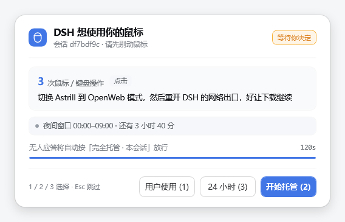
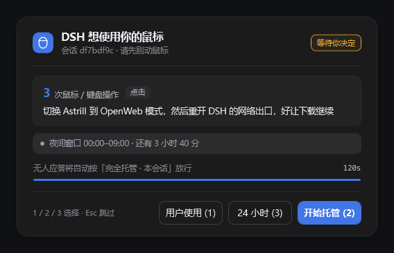

# dsh-mouse-guard

给 [DeepSeek Harness](https://github.com/deepseek-ai/deepseek-harness)（DSH）的 **Windows 桌面鼠标托管闸门**。

DSH 通过 `dsh-computer-use-win`（wincu）MCP server 操作鼠标键盘。问题是：**你正在用电脑的时候它也想动鼠标**，两边抢指针就会点错东西。

这个工具在 wincu 的 MCP server 里插一道闸门：任何会抢鼠标 / 键盘 / 前台焦点的调用，第一次都要先弹一张授权卡，由你决定放不放行。它还带一个**定时托管窗口**——比如凌晨 00:00–09:00 免授权放行，白天自动恢复门闩。





---

## 一眼看懂

```
agent 想调用 click / move / type_text ...
        │
        ▼
wincu MCP server（dsh-computer-use-win 的 mcp\server.mjs，已打闸门补丁）
        │  读 <工作区>\.dsh-mouse\consent.json 与 window.json
        ├─ 定时托管窗口内（如 00:00–09:00）─┐
        ├─ full-session 且会话一致 ─────────┤
        ├─ full-24h 且未过期 ───────────────┼─→ 放行（不打扰）
        ├─ blocked 冷却中 ─────────────────┴─→ 直接拒绝，并给模型可操作的替代方案
        └─ 其它（默认）
                │
                ▼
        mouse-consent.ps1   授权弹窗（次数 / 理由 / 工具名 / 定时窗口状态 / 倒计时）
                │
                ├─ 用户使用          → 写 blocked（冷却 10 分钟，期间直接拒绝、不再弹窗）
                ├─ 开始托管（本会话） → 写 full-session + 当前会话 id
                ├─ 24 小时           → 写 full-24h + expiresAt
                └─ 无人应答（120s）   → 按「本会话托管」放行，结果里标 timeout=true
```

## 为什么闸门打在 wincu 的 MCP server 里

`dsh-computer-use-win` 的 MCP server 是**所有**物理鼠标 / 键盘调用的必经之路：主 agent、子 agent、workflow 里的无人值守 agent 都走同一个 server 进程。在它内部拦一道，等于给整机鼠标上了一把总锁，不依赖调用方自觉。

DSH 自带 `PreToolUse` hook 也能拦，但实测有两个坑：它的 `ask` 会走 DSH 自己的审批 UI，而审批策略为 `never` 时会被自动拒绝；`deny` 只能整条拦死，拿不到「预计几次」这种由 agent 现场声明的信息。所以 hook 只作可选兜底，主力放在 server 闸门。

## 界面

设计语言直接对齐 DSH 自己的前端 token（从 `app.asar` 里的 `--dsw-*` 变量取），不自己编颜色：

| 用途 | token | 浅色 | 深色 |
|---|---|---|---|
| 卡片底 | `--dsw-alias-bg-base` | `#FFFFFF` | `#1B1B1C` |
| 信息块 | `--dsw-alias-bg-layer-2` | `#F9FAFB` | `#232324` |
| 描边 | `--dsw-alias-border-l2` | `12%` 黑 | `12%` 白 |
| 主文字 | `--dsw-alias-label-primary` | `#0F1115` | `#EBEEF2` |
| 主色 | `--dsw-static-deepseek-500` | `#4176E6` | 同 |
| 圆角 | `--dsw-radius-md` / `lg` | 12 / 16px | 同 |

- **跟随系统深浅色**（读 `AppsUseLightTheme`），也可 `-Theme light|dark` 强制
- 布局按 DSH 对话框：标题行 → 说明 → 信息块 → 状态行 → 倒计时 → **右对齐按钮组**
- 保留 `Topmost` + 响一声，确保被看见；去掉了旧版的琥珀呼吸光（DSH 不这么画）
- 三个按钮都带 `AutomationProperties.Name`，UIA 能精确定位并点击

> ⚠ WPF 的 8 位色是 `#AARRGGBB`，CSS 是 `#RRGGBBAA`。直接喂会静默画错（12% 白会变成不透明亮黄）。脚本里有 `To-WpfColor` 换位。

## 定时托管窗口

让「凌晨无人值守」成为可能：窗口内完全不弹窗。

```powershell
# 看状态（是否启用 / 窗口区间 / 此刻是否放行 / 急停 / 当前 consent 模式）
powershell -ExecutionPolicy Bypass -File tools\mouse-guard\window.ps1 status

# 改窗口（支持跨午夜：22:00–09:00）
powershell -ExecutionPolicy Bypass -File tools\mouse-guard\window.ps1 set 00:00 09:00

# 临时关闭 / 重开
powershell -ExecutionPolicy Bypass -File tools\mouse-guard\window.ps1 off
powershell -ExecutionPolicy Bypass -File tools\mouse-guard\window.ps1 on

# 急停：不管什么时间，一切物理点击一律拒绝
powershell -ExecutionPolicy Bypass -File tools\mouse-guard\window.ps1 stop
powershell -ExecutionPolicy Bypass -File tools\mouse-guard\window.ps1 resume
```

配置落在 `<工作区>\.dsh-mouse\window.json`：

```json
{
  "enabled": true,
  "start": "00:00",
  "end": "09:00",
  "note": "0 点后免授权，9 点恢复门闩"
}
```

- `start < end` → 同日窗口；`start > end` → 跨午夜；`start == end` → 全天
- 存在 `.dsh-mouse\STOP` 时**一律拒绝**，优先于时间窗
- 判定逻辑有 15 条边界用例：`node tools\mouse-guard\window-test.mjs`

## 文件

| 文件 | 作用 |
|---|---|
| `guard-inline.mjs` | 闸门源码 —— 被注入 `server.mjs` 的那份代码的**唯一真源** |
| `patch-server.mjs` | 幂等注入器：四处锚点校验 + `node --check` 语法自检 + 自动备份 + `--revert` |
| `mouse-consent.ps1` | 授权弹窗（三选项 + 倒计时 + 键盘 1/2/3 + `-Simulate` + `-PreviewPath`） |
| `mg.ps1` | 命令行：`status` / `grant` / `revoke` / `block` / `ask` / `notify` / `log` |
| `window.ps1` | 定时窗口开关：`status` / `on` / `off` / `stop` / `resume` / `set HH:MM HH:MM` |
| `window-test.mjs` | 时间窗判定的边界自测（15 例） |

运行时状态都在 `<工作区>\.dsh-mouse\`：

| 文件 | 含义 |
|---|---|
| `consent.json` | 授权状态：`idle` / `full-session` / `full-24h` / `blocked` |
| `window.json` | 定时托管窗口配置 |
| `STOP` | 急停标记（存在即全拒） |
| `plan.json` | agent 声明的本次计划（`calls` / `reason`），弹窗显示「预计 N 次」用 |
| `notice.json` | 给运载窗口的横幅（`mouse-request` / `mouse-granted` / `mouse-blocked`） |
| `guard.log` | 闸门日志（拦了谁、弹了几次、用户选了什么、窗口何时生效） |

## 安装

```powershell
# 1) 装 wincu（提供 MCP server）
npm install -g dsh-computer-use-win   # 或按 DSH 的 MCP 配置装进某个 profile

# 2) 打闸门（默认打 web profile；别的 profile 用 --target）
node tools\mouse-guard\patch-server.mjs --dry-run     # 先看四处锚点是否命中
node tools\mouse-guard\patch-server.mjs               # 真打，自动备份 server.mjs

# 3) 重启 MCP server 进程（它在启动时把 server.mjs 读进内存）
Get-CimInstance Win32_Process -Filter "Name='node.exe'" |
  Where-Object { $_.CommandLine -like '*dsh-computer-use-win*mcp*server.mjs*' } |
  ForEach-Object { Stop-Process -Id $_.ProcessId -Force }
```

不需要重启 DSH 宿主：`dsh-mcp-client` 自带 reconnect（指数退避），实测杀掉后 6 秒内新进程起来、工具表重新同步。

指定别的 profile：

```powershell
node tools\mouse-guard\patch-server.mjs --target "$env:USERPROFILE\.dsh\profiles\desktop\node_modules\dsh-computer-use-win\mcp\server.mjs"
```

插件升级会覆盖 `server.mjs`，重打即可（幂等）：

```powershell
node tools\mouse-guard\patch-server.mjs           # 已打过会跳过
node tools\mouse-guard\patch-server.mjs --force   # 改过 guard-inline.mjs 之后
node tools\mouse-guard\patch-server.mjs --revert  # 卸下闸门，恢复上游原样
```

## 预览（不弹窗、不抢前台）

改完 UI 想看看效果，直接离屏渲染成 PNG：

```powershell
powershell -STA -ExecutionPolicy Bypass -File tools\mouse-guard\mouse-consent.ps1 `
  -PreviewPath "$env:TEMP\consent.png" -Theme light `
  -Calls 3 -ToolName windows_computer_use_click `
  -Reason "在浏览器里点三个按钮，把导出队列跑起来" `
  -Session "df7bdf9c-7fce-43f7-a4cd-52fc5bd79eec"
```

## agent 侧约定

1. **动手用鼠标之前先申请一次**：`windows_computer_use_mouse_request`，参数 `calls`（预计次数）+ `reason`（一句话中文）。
   返回 `session` / `24h` → 放手做；返回 `user` → **不要**再调物理输入工具，改用只读工具
   （`snapshot` / `find` / `accessibility_tree` / `ocr`）+ UIA 的 `invoke` / `set_value` / `focus` /
   `activate_window`，或命令行脚本，或直接请用户操作。
2. 忘了申请也没关系：第一次 `click` / `move` / `type_text` 会自动弹同一个窗，只是次数显示「未声明」。
3. 需要提权（sandbox 升级）时先 `mg.ps1 notify -Kind permission -Text "..."`。

## 被拦下来的工具（9 个）

`click` · `double_click` · `move` · `drag` · `scroll` · `type_text` · `keypress` · `activate_window` · `focus`

只读工具（`snapshot` / `accessibility_tree` / `find` / `ocr` / `list_windows` / `wait` / `element_info` / `health`）
和 UIA 工具（`invoke` / `set_value` / `close_window` / `move_window`）**不弹窗**——它们不动物理指针。

`activate_window` / `focus` 也被拦，是因为它们虽然不动指针、但会抢前台焦点，照样会打断你打字。

## 边界

- 只覆盖走 wincu 的调用。别的途径（PowerShell 里自己 P/Invoke `SendInput`、第三方工具）不在此列。
- 弹窗由 MCP server 的 node 进程 spawn；若该进程被强杀，正在等的弹窗会一起被收走（下次调用会重弹）。
- 并发调用做了「单飞」：多个 agent 同时要鼠标只会弹一个窗，其余等同一份结果。
- `-Simulate user|session|24h` 是自测通道：不弹窗、直接出结果。
- 定时窗口内是**全部放行**，不是「只放行某个程序」。要收窄到进程白名单需要自己加。

## 环境变量

| 变量 | 作用 | 默认 |
|---|---|---|
| `DSH_MOUSE_WS` | 工作区根（`.dsh-mouse` 的父目录） | 相对 `$USERPROFILE\Documents\deepseek-harness\默认工作区` |
| `DSH_MOUSE_TIMEOUT_SEC` | 弹窗无人应答的秒数 | `120` |

## License

MIT
